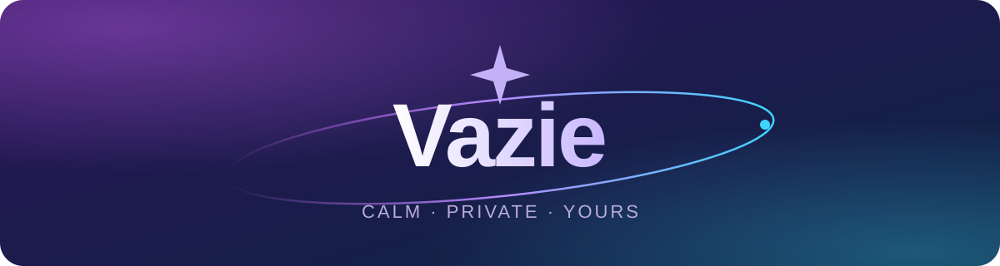
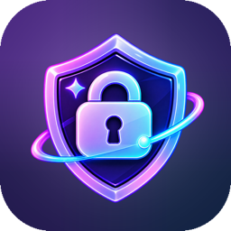
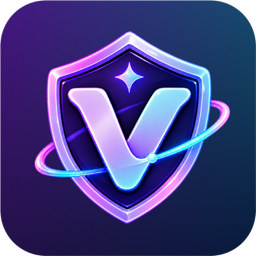

  <a href="https://github.com/vazie-app/.github/blob/main/profile/README.md">English</a> · <b>Русский</b>

  

Маленькие спокойные приложения, которые оставляют ваши данные <b>вам</b>.

  <a href="https://vazie.app">vazie.app</a> ·
  <a href="https://t.me/vazieapp">t.me/vazieapp</a> ·
  <a href="mailto:support@vazie.app">support@vazie.app</a>

 

<table>
  <tr>
    <td width="96" align="center"></td>
    <td>
      
<b><a href="https://github.com/vazie-app/VazieKeep">Vazie Keep</a></b>

      
Менеджер паролей для KeePass-файла, который у вас уже есть. Без аккаунта, без облака, без привязки.

    </td>
  </tr>
  <tr>
    <td width="96" align="center"></td>
    <td>
      
<b><a href="https://github.com/vazie-app/VazieVPN">Vazie VPN</a></b>

      
Клиент для ваших собственных VLESS-серверов — на Android и в браузере. Шифруется на устройстве, подключение в одно касание.

    </td>
  </tr>
</table>

 

### Принципы

- **Ваше.** Данные остаются на вашем устройстве, в форматах, которые можно забрать с собой.
- **Тихо.** Без рекламы, без навязчивых напоминаний, без аналитики.
- **Открыто.** Исходный код публичен — можно прочитать, что работает на вашем устройстве.

 

  Придумала и сделала <a href="https://t.me/vazovsky17">Vazovsky</a> · <a href="https://github.com/vazie-app/.github/blob/main/SECURITY.ru.md">Безопасность</a> · <a href="https://github.com/vazie-app/.github/blob/main/CONTRIBUTING.ru.md">Участие в проекте</a>

